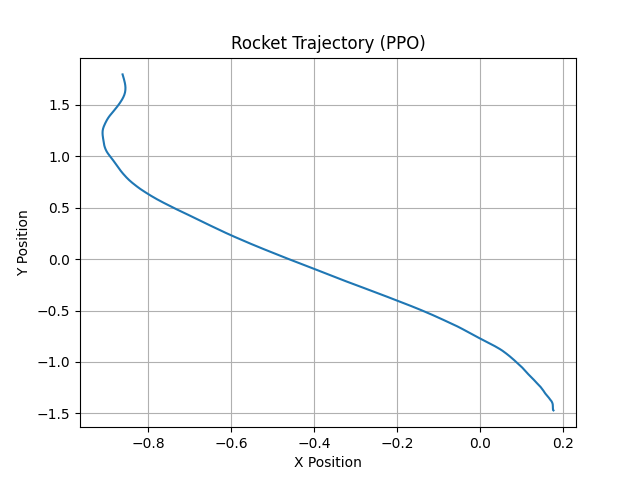

# Rocket Lander: Learned vs. Classical Control

[](https://github.com/adityaanilshukla/CM3070-Final-Project/actions/workflows/ci.yml)

> Active development happens on the [`showcase-rebuild`](https://github.com/adityaanilshukla/CM3070-Final-Project/tree/showcase-rebuild) branch (modern Gymnasium + Stable-Baselines3 stack, SAC/PPO/classical comparison). The CI badge above tracks that branch.

A simulation study comparing two approaches to the problem of landing a rocket
booster on a platform: a **learned controller** trained with reinforcement
learning (Proximal Policy Optimization) and a **hand-designed controller** built
as a finite state machine with PID loops. Both control the same physics
simulation; the project measures how they differ in landing success and in the
quality of the control they produce.



## Research question

> On a 2D rocket soft-landing task, how does a policy learned from reward
> compare against an explicitly engineered state-machine controller, in terms of
> landing success rate and control quality (stability, precision, and control
> smoothness)?

The motivation is the contrast between the two control paradigms. The FSM
encodes a human's step-by-step landing procedure (orient, cancel horizontal
drift, descend, touch down) with tuned thresholds. The PPO agent is given only a
reward signal and discovers a policy on its own. Comparing them on identical
dynamics isolates what each paradigm buys you.

## The environment

The simulation (`rocket_lander.py`) is a Box2D rigid-body model of a rocket
descending toward a landing pad, adapted from the open-source RocketLander
environment and exposed through the OpenAI Gym API.

- **Observation (10-D):** horizontal and vertical position relative to the pad,
  body angle, two landing-leg contact flags, current throttle and engine gimbal,
  and the three velocity components.
- **Actions (discrete):** nudge the engine gimbal left/right, throttle up/down,
  fire the left/right side thruster, or do nothing.
- **Reward:** potential-based shaping toward a centered, upright, low-velocity
  touchdown, a fuel penalty, a large bonus for a stable landing, and a penalty
  for crashing or drifting out of bounds.

A landing counts as successful when both legs stay in contact with the pad at
low speed for a full second of simulated time.

## The two controllers

**PPO (learned).** Trained with Stable-Baselines PPO2 for 20M environment steps.
The training entry point is `train_ppo_model.py`; checkpoints are saved under
`model/`, and the TensorBoard logs are in `RocketLander_tensorboard/`.

**FSM + PID (engineered).** `fsm_controller.py` implements a finite state machine
that sequences the landing into phases and uses PID loops to drive the body
angle and descent rate, mapping their outputs onto the discrete actions.

## Evaluation

Each controller is run for 100 episodes (`eval_ppo.py`, `eval_fsm.py`) and
compared across several dimensions, with the figures generated by
`plot_results.py` into `plots/comparison/`:

- landing success rate,
- horizontal landing precision,
- attitude stability through the descent,
- gimbal and throttle control smoothness,
- action distribution.

Single-episode diagnostics (trajectory, velocities, gimbal and throttle traces)
for each controller are in `plots/single-episode/`.

Both controllers land the rocket in the large majority of episodes. The detailed
per-metric comparison is in the figures above.

> **Note on methodology.** This is a course project and the evaluation has known
> limitations: the two controllers are run on independent, unseeded initial
> conditions rather than a shared seeded test set, and some reported metrics
> (wall-clock timing, magnitude-based "smoothness") do not mean quite what their
> labels suggest. A rigorous, reproducible re-evaluation with seeded paired
> episodes, confidence intervals, and significance testing is in progress on the
> `showcase-rebuild` branch, which also ports the project to a modern
> Gymnasium + Stable-Baselines3 stack and adds SAC and an LQR baseline.

## Repository layout

| Path | Purpose |
|------|---------|
| `rocket_lander.py` | Box2D rocket-landing environment |
| `ppo_controller.py`, `train_ppo_model.py` | PPO model definition and training |
| `fsm_controller.py` | Finite-state-machine + PID controller |
| `run_ppo_model.py`, `run_fsm_model.py` | Roll out a single episode per controller |
| `eval_ppo.py`, `eval_fsm.py` | 100-episode evaluation producing per-metric data |
| `plot_results.py`, `plot_*_single_episode.py` | Figure generation |
| `model/` | Trained PPO checkpoints |
| `plots/` | Comparison and single-episode figures |

## Setup and usage

The code targets the legacy stack it was trained on: **Python 3.7**,
TensorFlow 1.13, and Stable-Baselines 2.10.

```bash
python3.7 -m venv rocket-lander-env
source rocket-lander-env/bin/activate        # Windows: rocket-lander-env\Scripts\activate
pip install setuptools==65.5.0               # needed before gym installs cleanly
pip install -r requirements.txt
```

Run a single landing with either controller:

```bash
python run_ppo_model.py      # learned policy
python run_fsm_model.py      # engineered controller
```

Reproduce the evaluation and figures:

```bash
python eval_ppo.py
python eval_fsm.py
python plot_results.py
```

## License and credits

The Box2D environment is adapted from the open-source RocketLander project.
Reinforcement learning is implemented with Stable-Baselines.
