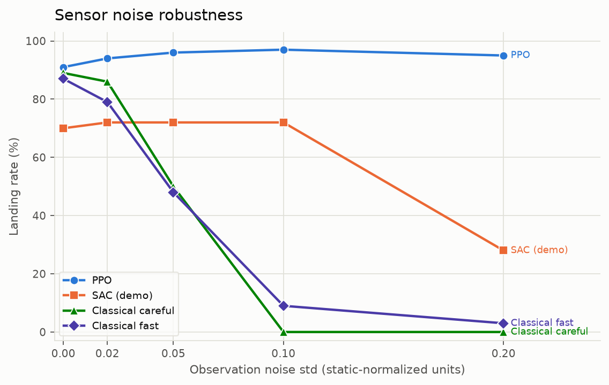
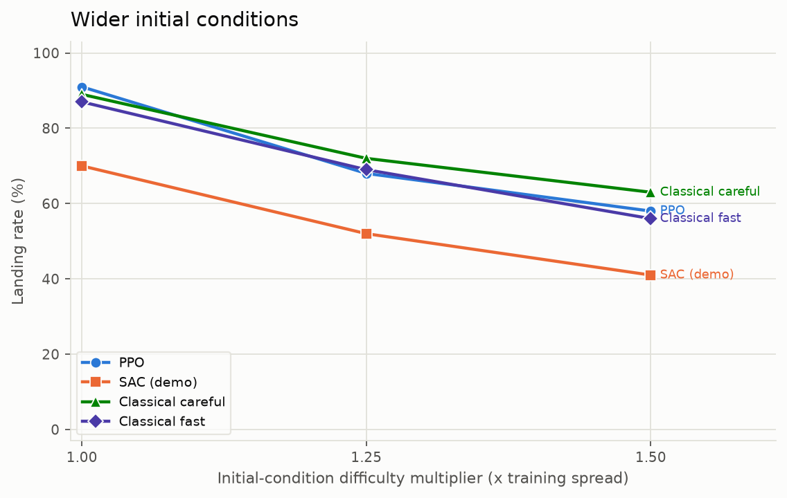
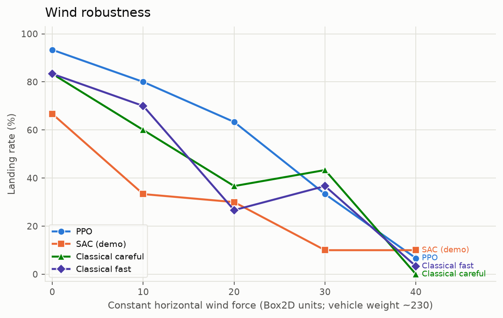
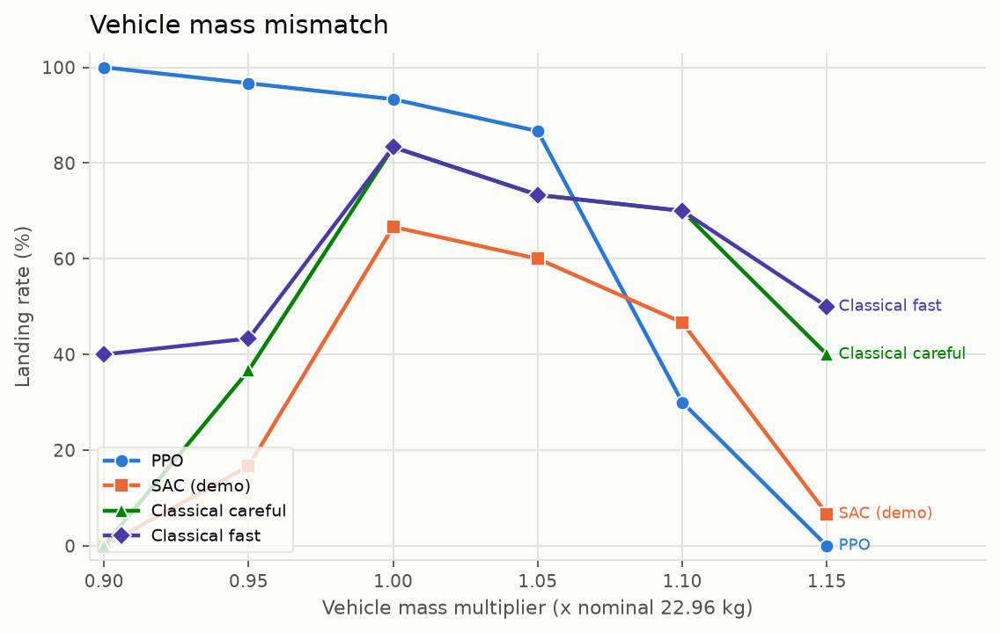

# Robustness and out-of-distribution generalization

Every controller was evaluated on the identical, shared bank of 30 seeded initial conditions (seeds 1000000..1000029), deterministically, at the 3000-step cap; landing is `info['landed']`. Each perturbation is applied identically to every controller at a given seed (shared realization), and defaults off so nominal evaluation is unchanged. Sensor noise is injected in the static-normalized observation space for all controllers (the raw-obs classical controllers receive the same noise scaled by `STATIC_OBS_STD`), so the physical corruption is identical; applying the std directly in raw-obs units instead would corrupt the classical controllers ~10-20x harder and is not what is reported here.

## Sensor noise robustness

| Controller | 0 | 0.02 | 0.05 | 0.1 | 0.2 |
|---|---|---|---|---|---|
| PPO | 93% | 97% | 97% | 97% | 97% |
| SAC (demo) | 67% | 70% | 70% | 70% | 20% |
| Classical careful | 83% | 83% | 53% | 0% | 0% |
| Classical fast | 83% | 77% | 60% | 10% | 3% |

*x-axis: Observation noise std (static-normalized units). Cells are landing rate (% of 30 seeds).*

## Wider initial conditions

| Controller | 1 | 1.25 | 1.5 |
|---|---|---|---|
| PPO | 93% | 77% | 63% |
| SAC (demo) | 67% | 60% | 40% |
| Classical careful | 83% | 70% | 67% |
| Classical fast | 83% | 67% | 60% |

*x-axis: Initial-condition difficulty multiplier (x training spread). Cells are landing rate (% of 30 seeds).*

## Wind robustness

| Controller | 0 | 10 | 20 | 30 | 40 |
|---|---|---|---|---|---|
| PPO | 93% | 80% | 63% | 33% | 7% |
| SAC (demo) | 67% | 33% | 30% | 10% | 10% |
| Classical careful | 83% | 60% | 37% | 43% | 0% |
| Classical fast | 83% | 70% | 27% | 37% | 3% |

*x-axis: Constant horizontal wind force (Box2D units; vehicle weight ~230). Cells are landing rate (% of 30 seeds).*

## Vehicle mass mismatch

| Controller | 0.9 | 0.95 | 1 | 1.05 | 1.1 | 1.15 |
|---|---|---|---|---|---|---|
| PPO | 100% | 97% | 93% | 87% | 30% | 0% |
| SAC (demo) | 0% | 17% | 67% | 60% | 47% | 7% |
| Classical careful | 0% | 37% | 83% | 73% | 70% | 40% |
| Classical fast | 40% | 43% | 83% | 73% | 70% | 50% |

*x-axis: Vehicle mass multiplier (x nominal 22.96 kg). Cells are landing rate (% of 30 seeds).*

## Findings

<!-- Honest interpretation written below; see tables/figures. -->
